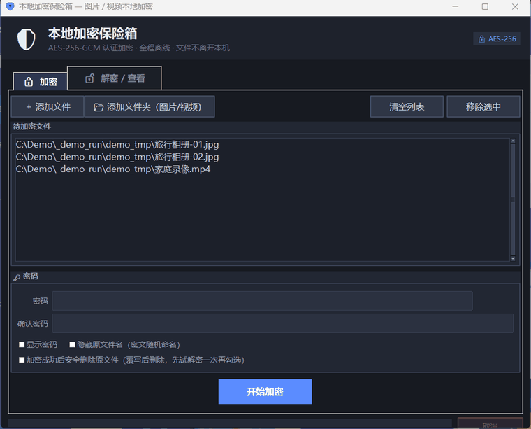

<div align="center">

# 🔐 本地加密保险箱 · SecureVault

**图片 / 视频本地加密工具 —— 密码错误，无法查看**

*Local image & video encryption — wrong password, no peeking.*

[](../../releases/latest)
[](LICENSE)
[](../../releases/latest)
[](#-安全原理-security)



**🔒 加密 → 变成密文 · ❌ 密码错误 → 一个字节都解不出 · 👁 预览看完即焚**

</div>

---

[中文](#-功能特性) | [English](#-features)

## ✨ 功能特性

- 🔒 **真加密，不是隐藏** — AES-256-GCM 认证加密 + PBKDF2-SHA256 600,000 次迭代派生密钥。密码错误时在密码学层面直接失败，**无法查看、无法绕过**
- 👁 **临时预览，看完即焚** — 解密到系统临时目录并直接打开，看完一键**覆写清除**，本地不留任何副本
- 🙈 **隐藏原文件名** — 密文随机命名（如 `SV-3FA2B1C9.svenc`），外人连文件名都看不到；解密时自动还原
- 🗑 **安全删除** — 原文件先覆写随机数据再删除
- 🛡 **防篡改** — GCM 完整性校验，密文被动过一根手指都会拒绝解密
- 📦 **免安装** — 单文件 exe，双击即用，无需 Python；全程离线，数据永不离开本机
- 🖥 **现代化深色界面** — 密码强度实时提示、批量处理、进度条、彩色日志、右键菜单、高 DPI 支持

## 🚀 快速开始

到 [**Releases**](../../releases/latest) 下载 `SecureVault.exe`（≈15 MB），双击运行：

1. **加密**：添加文件 / 整个文件夹（自动找出图片视频）→ 输入密码 → 开始加密
2. **解密**：选择 `.svenc` 文件 → 输入密码 → 解密到原位置，或「解密并预览」看完自动清理
3. 密码错误 → 立即停止，什么都不显示
> 🔎 **校验下载**：下载后可用 PowerShell 核对文件完整性，与 [Release 说明](../../releases/latest) 中的 SHA-256 一致即为未篡改：`Get-FileHash .\SecureVault.exe -Algorithm SHA256`

> ⚠️ **密码遗忘 = 文件永远打不开**（AES-256 无法找回），请牢记密码。

### 从源码运行

```bash
pip install cryptography
python secure_vault.py             # 图形界面
python secure_vault.py --selftest  # 10 项安全自检
```

## 📖 使用场景

- 私人相册 / 录像加密存放，电脑借人、送修时不担心
- 加密后上传网盘，钥匙（密码）只在自己手里
- 把 `.svenc` 文件发给别人，另行告知密码

## 🔬 安全原理 (Security)

| 环节 | 方案 |
|---|---|
| 加密算法 | AES-256-GCM（认证加密） |
| 密钥派生 | PBKDF2-HMAC-SHA256 · 600,000 iterations · 16-byte random salt |
| Nonce | 每文件独立 96-bit 随机 nonce |
| 完整性 | GCM authentication tag |
| 文件名 | Encrypted inside the ciphertext |
| 防暴力破解 | 错误密码附加延迟 + 高迭代 KDF |

加密文件格式：`MAGIC(9) | salt(16) | nonce(12) | AES-GCM( 校验值 | 文件名 | 内容 ) | tag(16)`

## ❓ FAQ

**Q: 忘记密码能找回吗？** 不能。这是特性不是缺陷——没有任何后门、没有找回机制。

**Q: 和 VeraCrypt / Picocrypt 有什么区别？** 它们是通用加密工具；SecureVault 专注**媒体文件 + 中文界面 + 免安装 + 临时预览**场景，开箱即用。

**Q: 支持多大文件？** 流式读写不占内存，单文件上限约 64 GB（GCM 限制）。

**Q: 是安全的吗？** 源码仅 ~1300 行 Python，可完整审计；核心使用业界标准库 `cryptography`，没有自造加密。

## ⭐ 支持项目

如果这个工具帮到了你，点一个 **Star** 让更多人看到！

<a href="https://github.com/lilneil10n11neverdie/SecureVault/stargazers"></a>

## 📄 License

[MIT](LICENSE)

---

<div align="center">

## ✨ Features (English)

**Local image & video encryption — wrong password, no peeking.**

- 🔒 **Real encryption, not hiding** — AES-256-GCM + PBKDF2-SHA256 (600k iterations). A wrong password fails cryptographically; there is no way around it.
- 👁 **Preview & burn** — decrypts to a temp dir, opens with your default viewer, then one click **overwrites & wipes** the temp copies.
- 🙈 **Filename hiding** — ciphertexts get random names like `SV-3FA2B1C9.svenc`; original names are stored encrypted and restored on decrypt.
- 🗑 **Secure delete** — originals are overwritten with random data before deletion.
- 🛡 **Tamper-proof** — GCM integrity check rejects any modified ciphertext.
- 📦 **Zero install** — single portable exe, fully offline. No Python needed.
- 🖥 **Modern dark UI** — strength meter, batch mode, progress, colored log, HiDPI.

### Quick start

Download [`SecureVault.exe`](../../releases/latest), double-click, done. > 🔎 **Verify your download**: `Get-FileHash .\SecureVault.exe -Algorithm SHA256` — compare against the SHA-256 in the [release notes](../../releases/latest).
Or run from source:

```bash
pip install cryptography
python secure_vault.py --selftest
```

> ⚠️ **Forgot the password = files are gone forever.** No backdoor, no recovery.

If this tool helps you, please give it a **Star** ⭐ — it really helps others discover it.

</div>
